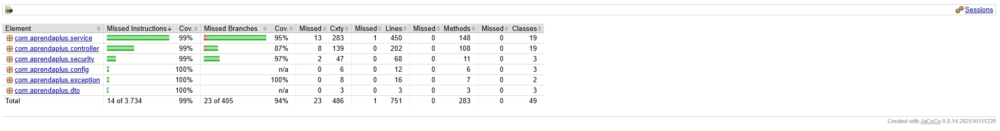
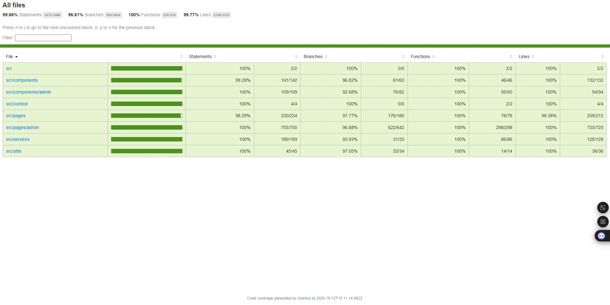

# AprendaPlus 🎓

Plataforma web de **venda de cursos superiores e profissionalizantes**. Tem uma loja virtual e uma área do aluno para quem compra, e um painel administrativo para a equipe da instituição.

Projeto final do curso **Desenvolvimento Full Stack** do programa **+PraTi / Codifica**.

| | Link |
|---|---|
| 🌐 **Site (front-end)** | https://nattalyb.github.io/aprenda-plus/ |
| ⚙️ **API (back-end)** | https://aprenda-plus-backend.onrender.com |
| 🔐 **Painel administrativo** | https://nattalyb.github.io/aprenda-plus/#/admin/login |

> **Atenção:** o back-end está no plano gratuito do Render, que "adormece" o servidor depois de alguns minutos sem uso. Por isso, o primeiro acesso pode levar até 1 minuto para carregar os cursos. Depois disso, o site responde normalmente.

---

## 📑 Sumário

- [Funcionalidades](#-funcionalidades)
- [Fluxo da inscrição até a matrícula](#-fluxo-da-inscrição-até-a-matrícula)
- [Financeiro](#-financeiro)
- [Comercial](#-comercial)
- [Documento de escolaridade e e-mails](#-documento-de-escolaridade-e-e-mails)
- [Sala de aula EAD](#-sala-de-aula-ead)
- [Recuperação de senha](#-recuperação-de-senha)
- [Importação por planilha](#-importação-por-planilha)
- [Tecnologias](#-tecnologias)
- [Arquitetura](#-arquitetura)
- [Estrutura de pastas](#-estrutura-de-pastas)
- [Como rodar localmente](#-como-rodar-localmente)
- [Testes e cobertura](#-testes-e-cobertura)
- [Segurança](#-segurança)
- [Decisões de projeto](#-decisões-de-projeto)
- [Deploy](#-deploy)
- [Metodologia de trabalho](#-metodologia-de-trabalho)
- [Melhorias futuras](#-melhorias-futuras)
- [Equipe](#-equipe)

---

## ✨ Funcionalidades

### Parte I: Site da instituição

**Vitrine e busca**

- **Vitrine "Cursos mais vendidos"**, com imagem, nome, mensalidade e valor total de cada curso.
- **Busca de cursos** que ignora acentos e maiúsculas ("ciencia" encontra "Ciência de Dados"). Mostra **sugestões** enquanto o aluno digita e aceita navegação pelo teclado.
- **Navegação clara:**
  - Todas as telas têm o link **"← Voltar ao início"** logo abaixo da logo. Durante uma pesquisa, ele vira **"← Ver todos os cursos"**.
  - Clicar na logo também volta ao início e limpa a pesquisa anterior.
- **Topo padronizado:** para o aluno logado, a ordem é sempre **Minhas inscrições · Carrinho · nome do aluno + Sair**.
- **Detalhes do curso** em um modal: descrição, carga horária, modalidade, pré-requisitos e conteúdo programático em tópicos.
- **Preço em mensalidades:** cada curso mostra o valor mensal em destaque (ex.: *R$ 500,00/mês em 24x*) e o valor total logo abaixo.

**Cadastro e login**

- **Cadastro e login de alunos**, com validação de todos os campos (exceto o complemento do endereço).
- **Máscaras no CPF e no telefone** (`000.000.000-00` e `(51) 99999-9999`, que se ajusta para telefone fixo), com a biblioteca `react-number-format`. O CPF é enviado ao servidor só com os números.
- **Senha com "olho"** para mostrar o que foi digitado e campo **Confirmar senha**, que avisa na hora se as duas são iguais (mínimo de 6 caracteres).
- **Esqueci minha senha:** o aluno recebe por e-mail um link para criar uma nova senha (veja [Recuperação de senha](#-recuperação-de-senha)).
- **Endereço preenchido pelo CEP:** ao digitar o CEP, rua, bairro, cidade e estado são preenchidos automaticamente pela API pública do ViaCEP.
- **Contas inativas ou bloqueadas** não conseguem entrar nem comprar. A tela explica o motivo.
- **Certificado de conclusão no cadastro:** o aluno anexa o certificado (ou histórico) de conclusão do ensino médio em **PDF, JPG ou PNG** (até 5 MB), clicando ou arrastando o arquivo. O documento fica salvo no banco de dados (veja [Documento de escolaridade](#-documento-de-escolaridade-e-e-mails)).

**Carrinho e pagamento**

- **Carrinho de compras** com contador no topo da página, que se atualiza na hora.
- **Formas de pagamento:**
  - **Pix** à vista com **5% de desconto**;
  - **Cartão de crédito** e **boleto**, parcelados sem juros. Na compra de vários cursos juntos, vale o **maior** limite de parcelas entre os cursos do carrinho.
- **Lembrete do certificado:** quem ainda não enviou o certificado de conclusão (ou teve o documento recusado) vê um aviso no carrinho e pode anexar o arquivo ali mesmo, antes de concluir a compra.
- **Conclusão da inscrição:** cria uma inscrição para cada curso na primeira turma aberta **com vaga**. Se todas as turmas abertas estiverem cheias, o aluno entra na **lista de espera** (veja o [fluxo](#-fluxo-da-inscrição-até-a-matrícula)). O valor de cada inscrição é **calculado pelo servidor** a partir do preço do curso, e não pelo navegador.

**Área do aluno: "Minhas inscrições"**

- Lista os cursos do aluno, com turma, horário, forma de pagamento, valor e status.
- **Troca de turma:** o aluno pode trocar para outra turma do mesmo curso. Aparecem só as turmas disponíveis (com vaga), com horário, modalidade e período, sem mostrar a quantidade de vagas.
- Para quem está na **lista de espera**, um aviso explica o que acontece quando uma vaga abrir.
- **Meus pagamentos:** em cada curso, o aluno vê quantas parcelas já pagou, a próxima a vencer e as que estão em atraso, com a lista completa das parcelas.
- **Recibo:** cada parcela paga tem um recibo pronto para imprimir ou salvar em PDF.
- **Documento de escolaridade:** o aluno acompanha a análise do certificado (*em análise*, *aprovado* ou *recusado*). Se for recusado, vê o motivo e envia um novo arquivo ali mesmo.
- Cada curso confirmado tem o atalho **"Entrar na sala de aula"**.

**Sala de aula EAD** (detalhes na seção [Sala de aula EAD](#-sala-de-aula-ead))

- Depois da matrícula confirmada, o aluno entra com o **mesmo e-mail e senha** e encontra as turmas dele em **🎓 Sala de aula**, cada uma com a barra de progresso.
- Aulas em vídeo (YouTube), texto e material de apoio, organizadas por disciplina. Aulas com data de liberação aparecem com cadeado até o dia certo.
- O aluno marca cada aula como **concluída** e acompanha o percentual do curso.
- **Mural de avisos** da turma, com avisos fixados no topo.
- **Certificado de conclusão** liberado ao terminar todas as aulas, pronto para imprimir ou salvar em PDF, com **código de verificação**.
- **Validar certificado:** qualquer pessoa digita o código no site (link no rodapé) e confere se o certificado é verdadeiro.

**Geral**

- **Avisos visuais (toasts)** de sucesso, erro e alerta.
- **Layout responsivo** para celular, tablet e computador.

### Parte II: Painel administrativo

**Acesso, níveis e início do painel**

- **Login exclusivo para funcionários**, separado do login de alunos.
- **Níveis de acesso:** cada funcionário tem um nível (ex.: Master, Administrativo, Secretaria, Financeiro) que define os **módulos** do painel que ele pode usar.
  - O **Master** tem acesso a tudo e é o único que entra no módulo **Sistema**.
  - No **Sistema**, o Master cria níveis novos com nome livre (ex.: Contabilidade) e marca, numa tabela, os módulos de cada nível.
  - **Cor de cada nível:** o Master escolhe a cor da etiqueta de cada nível (inclusive do Master). Todo mundo do mesmo nível aparece com a mesma cor na lista de funcionários, no menu lateral e no início do painel. O texto da etiqueta fica branco ou escuro sozinho, para sempre dar para ler (script `database/cores-dos-niveis.sql`).
  - Sem um módulo liberado, ele some do menu e dos atalhos, e o servidor recusa criar, editar ou excluir nele.
  - As mudanças valem na hora, sem precisar sair e entrar de novo.
- **Início do painel:** ao entrar, o funcionário vê só quadrados de atalho para os módulos do nível dele.
- **Menu lateral recolhível:** o botão « recolhe o menu e deixa só os ícones. Passando o mouse por cima, aparece o nome do item. O painel lembra a escolha.
- **CRUD completo** de:
  - Alunos
  - Professores
  - Cursos (com número de parcelas e prévia da mensalidade)
  - Disciplinas
  - Períodos letivos
  - Turmas
  - Matrículas
  - **Funcionários do painel**
- **Funcionários do painel:** mais pessoas da equipe podem ter acesso ao painel, cada uma com o seu nível de acesso.
  - A senha é obrigatória no cadastro (mínimo de 6 caracteres) e, na edição, a atual é mantida se o campo ficar em branco.
  - Funcionário inativo ou bloqueado não consegue entrar, e perde o acesso na hora se for bloqueado com a sessão aberta.
  - Ninguém consegue excluir, inativar ou mudar o nível da **própria** conta.
  - Só um Master pode criar, alterar ou excluir contas Master.

**Cursos, disciplinas e professores**

- **Disciplina em vários cursos:** a mesma disciplina pode fazer parte de mais de um curso (relação N:N), com a mesma carga horária em todos.
- **Professores × cursos e disciplinas:** no cadastro do professor, o admin marca os cursos que ele leciona e, dentro de cada curso, as disciplinas.
- **Total de horas do professor:** o sistema soma a carga horária das disciplinas do professor. Disciplinas **inativas** aparecem destacadas e não entram no total.

**Turmas e inscrições**

- **Status das turmas:**
  - Inscrições abertas
  - Inscrições encerradas
  - Em andamento
  - Concluída
  - Cancelada

  Só turmas com inscrições abertas recebem alunos.
- **Alunos da turma:** a lista de turmas mostra quantos alunos estão matriculados em cada uma (ex.: *👥 28 / 40*). Um clique abre a lista com o nome, o e-mail, a data e a situação de cada matrícula, e cada nome leva ao cadastro do aluno.
- **Inscrições:** listagem com a forma de pagamento escolhida pelo aluno e troca de status direto na tabela. Ao **confirmar o pagamento**, a matrícula é criada automaticamente.
- **Revisão do documento:** a coluna *Documento* mostra a situação do certificado de cada aluno. Um clique abre o arquivo (PDF ou foto) na própria tela, com os botões **Aprovar** e **Recusar** (a recusa pede o motivo). O pagamento só pode ser confirmado depois que o documento for aprovado. O certificado também aparece na edição do aluno.
- **Notificações 🔔:** um sininho no topo do painel, que confere tudo a cada minuto. **Cada nível só é avisado do que pode resolver:**
  - módulo **Inscrições:** inscrições novas desde a última vez que o funcionário olhou;
  - módulo **Alunos:** **documentos aguardando análise**, com um atalho para a lista já filtrada (o Financeiro não recebe esse aviso);
  - módulo **Financeiro:** **boletos** em atraso e os que vencem nos próximos 7 dias (Pix e cartão caem sozinhos e não geram aviso).
  - O número no sininho conta só o que ainda **não foi lido**. Abrir uma área ("Ver financeiro", "Analisar documentos", "Ver inscrições") ou clicar em **"Marcar todas como lidas"** zera o número; ele só volta quando chega algo novo (ou quando um boleto que estava "vencendo" passa a estar atrasado). Cada funcionário tem as suas próprias marcações.
  - O painel fecha com Esc, clicando fora ou mudando de tela.

**Sala de aula (EAD)**

- Escolha a turma e o professor responsável, e monte as aulas: título, disciplina, tipo (videoaula, leitura, ao vivo ou atividade), link do YouTube (com prévia do vídeo), material de apoio, texto, duração e data de liberação. Uma aula pode ficar como **rascunho** até estar pronta.
- Mude a ordem das aulas com as setas e **copie as aulas de outra turma** do mesmo curso com um clique.
- **Mural:** publique avisos para a turma, fixe os importantes e, se quiser, avise os alunos por e-mail. Os avisos podem ser **editados** depois (sem mandar o e-mail de novo) ou excluídos.
- **Andamento:** progresso de cada aluno, última atividade, quem concluiu e quem já emitiu o certificado.

**Financeiro** (detalhes na seção [Financeiro](#-financeiro))

- Painel com indicadores e gráficos de receita.
- Lista de todas as parcelas, com baixa dos boletos, estorno, exportação para planilha e impressão. Pix e cartão de crédito são **cobrança automática**: não precisam de baixa.

**Importação por planilha** (detalhes na seção [Importação por planilha](#-importação-por-planilha))

- Botão **📥 Importar planilha** em alunos, professores, cursos, disciplinas e nas aulas da Sala de aula (EAD): cadastra dezenas de registros de uma vez, com prévia linha a linha antes de gravar.

**Listas e mensagens**

- **Paginação em todas as listas de cadastro:** 20 registros por página (dá para trocar para 30 ou 50), com "Mostrando 21–40 de 132". Ao buscar ou filtrar, a lista volta para a primeira página.
- **Filtros em todas as listas:**
  - busca por nome (e por CPF em alunos, professores e matrículas);
  - filtros por categoria, curso ou status.
- **Ordenação em todas as listas:** basta clicar no nome da coluna (ID, nome de A-Z ou Z-A, valor, data, status...). Clicando de novo, a ordem inverte.
- **Mensagens de erro detalhadas:** quando o back-end recusa um dado, o formulário mostra exatamente qual campo está errado.
- **Exclusão segura:** não é possível excluir um registro que ainda está em uso (por exemplo, uma turma com inscrições). O painel explica o motivo, em vez de apagar e deixar dados "órfãos".

---

## 🔄 Fluxo da inscrição até a matrícula

```
     cadastro com o certificado de conclusão
                       │
                 compra no site
                       │
        ┌──────────────┴───────────────┐
   turma com vaga               todas as turmas cheias
        │                              │
        ▼                              ▼
 PENDENTE DE PAGAMENTO  ◀────  AGUARDANDO VAGA (lista de espera)
        │              abriu vaga     · não ocupa vaga
        │              (automático)   · ainda não paga
        ▼
 secretaria aprova o DOCUMENTO de escolaridade
        │
        ▼
 CONFIRMADA (admin aprova o pagamento)
        │
        ├──▶ MATRÍCULA "ativa" criada automaticamente
        ├──▶ E-MAIL de matrícula confirmada para o aluno
        └──▶ acesso à SALA DE AULA ──▶ todas as aulas concluídas ──▶ CERTIFICADO
```

- **Inscrição × matrícula:**
  - A **inscrição** é o pedido do aluno, com a forma de pagamento escolhida.
  - A **matrícula** é o vínculo oficial do aluno com a turma. Ela é criada **sozinha** quando o admin muda a inscrição para *Confirmada*, sem duplicar se já existir.
- **Lista de espera:** quem está *aguardando vaga* não ocupa vaga na turma. Quando uma vaga é liberada, a inscrição **mais antiga** da fila passa automaticamente para *pendente de pagamento*. Uma vaga é liberada quando:
  - o admin cancela ou exclui uma inscrição;
  - um aluno troca de turma.
- **Sair da fila pelo painel:** o admin só consegue tirar alguém da lista de espera se a turma tiver vaga. Se não tiver, o painel avisa: *"A turma X não tem vaga. A inscrição continua aguardando vaga."*
- **Cancelar ou concluir:** cancelar a inscrição também cancela a matrícula, e concluir a inscrição conclui a matrícula.
- **Troca de turma:** quem está na lista de espera e troca para uma turma com vaga sai da fila na hora. Se o aluno já tem matrícula, ela acompanha a inscrição para a nova turma.

---

## 💰 Financeiro

O módulo Financeiro usa a tabela `pagamento`, que já estava no modelo do banco desde o começo: cada parcela fica ligada à matrícula, com número, valor, vencimento, data em que foi paga, forma de pagamento e situação (a vencer, paga, atrasada ou cancelada).

**Parcelas automáticas**

- Quando o pagamento de uma inscrição é confirmado e a matrícula é criada, as parcelas são geradas sozinhas:
  - **Pix:** uma parcela única, já paga;
  - **cartão ou boleto em Nx:** N parcelas mensais, a primeira vencendo uma semana depois da confirmação. Os centavos que sobram da divisão entram na última parcela.
- **Cobrança automática (Pix e cartão):** com Pix ou cartão de crédito, o dinheiro cai sozinho para a faculdade, então ninguém precisa acompanhar essas parcelas. O Pix já nasce pago e cada parcela do cartão vira **paga sozinha no dia do vencimento**. Elas nunca ficam atrasadas, não entram nos avisos do sininho e o pagamento delas não pode ser desfeito.
- Quem decide se a parcela é automática é a **forma escolhida na compra** (a da inscrição), e não a forma gravada numa baixa. Assim, um boleto que foi pago por Pix no balcão continua sendo boleto se a baixa for desfeita.
- **Boleto** que passa do vencimento sem pagamento vira **atrasado** automaticamente.
- Cancelar a inscrição cancela as parcelas em aberto (as pagas continuam no histórico). Se a inscrição for confirmada de novo, elas são reabertas.
- Para matrículas que já existiam antes do módulo, o botão **"Gerar parcelas que faltam"** cria as parcelas a partir da inscrição confirmada.

**Visão geral (indicadores e gráficos)**

| Indicador | O que mostra |
|---|---|
| Previsto no mês | Soma das parcelas que vencem no mês atual |
| Recebido no mês | O que foi pago no mês, e quanto isso representa do previsto |
| Em atraso | Valor e quantidade de parcelas atrasadas |
| Inadimplência | Do que já venceu, quanto não foi pago (%) |
| A receber | Total das parcelas em aberto |

- **Receita por mês:** previsto × recebido nos últimos seis meses e nos próximos seis, com os valores ao passar o mouse e a opção "Ver em tabela".
- **Receita por curso** e **formas de pagamento**, com valor e porcentagem.

**Parcelas**

- Filtros por situação e busca por aluno ou curso, com o total do que está filtrado:
  - **A vencer** e **Atrasadas:** só boletos, que são o que o financeiro precisa acompanhar;
  - **Automáticas:** parcelas do cartão que ainda vão cair (aparecem com a etiqueta roxa *Automática* e o aviso "Cai sozinha no vencimento", sem botão de baixa);
  - **Pagas** e **Canceladas**.
- **Registrar pagamento** (boletos): informa a data (não pode ser no futuro) e a forma. Uma baixa feita por engano pode ser **desfeita**.
- **Exportar planilha** (CSV que o Excel abre direto) e **imprimir** a lista.

**Para o aluno:** em "Minhas inscrições", cada curso mostra as parcelas e o recibo das que foram pagas.

---

## 📈 Comercial

Módulo do painel para a equipe de vendas e marketing (script `database/modulo-comercial.sql`).

**De onde vêm os dados**

- O site registra três tipos de evento: **busca** (o termo e quantos cursos ela encontrou), **curso aberto** e **curso posto no carrinho**.
- A busca só é registrada quando a pessoa para de digitar (1,2 s), e cada termo conta uma vez por visita, para não contar "c", "ci", "cie"...
- **Visitante sem login é anônimo:** o navegador guarda só um código aleatório de sessão (UUID). Não há nome, e-mail nem IP. Quando a pessoa está logada como aluno, o id dela vem do token (nunca do corpo da requisição).
- A rota `POST /eventos` é pública, então o servidor confere tudo: tipo, formato do código de sessão, se o curso existe e o tamanho do termo. Esses eventos não entram no Histórico de alterações.
- Se o servidor estiver fora do ar, o site segue funcionando normalmente (os envios são "de fundo").

**Visão geral (7, 30 ou 90 dias)**

- Indicadores: visitantes, novos cadastros, inscrições, matrículas, **conversão** (visitantes que se matricularam) e **buscas sem resultado**.
- **Funil de vendas:** visitaram o site → abriram um curso → puseram no carrinho → fizeram inscrição → matricularam, com a perda (%) entre uma etapa e outra.
- **Compras para recuperar:** quantas pessoas pararam em cada etapa e o valor parado em pagamentos pendentes e carrinhos.
- Gráfico de **visitantes por dia** (com dica ao passar o mouse e versão em tabela).

**Leads**

- Uma linha por aluno ativo que começou a comprar e não terminou, na etapa mais avançada a que chegou:
  - **Pagamento pendente:** fez a inscrição e não pagou;
  - **Carrinho abandonado:** pôs cursos no carrinho e não finalizou;
  - **Só cadastro:** criou a conta e nunca comprou (com os cursos que abriu no site nos últimos 90 dias).
- Etiqueta **"Já é aluno"** para quem já tem matrícula (bom para oferecer um segundo curso).
- Filtros por etapa, busca (nome, e-mail, telefone ou curso), tempo parado, "só quem aceita ofertas" e "esconder quem não tem interesse".
- **Mensagem pronta** para cada etapa, com botão para abrir no **WhatsApp** ou no e-mail.
- **Registro de contatos:** canal (WhatsApp, telefone, e-mail), resultado (não respondeu, interessado, pediu retorno depois, sem interesse, matriculou) e observação. A lista mostra o último contato e quem fez.
- **Exportar planilha** (CSV que abre direto no Excel) com os leads filtrados.

**Interesse nos cursos**

- Cursos ordenados pelo interesse: pessoas que abriram (visitantes x alunos logados), carrinho, inscrições e conversão. Cursos que ninguém abriu aparecem em cinza.
- **Termos mais buscados** e **"procuraram e não encontraram"**: ideias de cursos novos ou de palavras para usar nos nomes e descrições.

**LGPD**

- No cadastro, a pessoa marca (opcional, começa desmarcado) se quer receber novidades e ofertas. No painel, a secretaria pode desmarcar quando o aluno pedir.
- Lembrete sobre uma compra parada pode ser feito com qualquer aluno; campanhas, só para quem aceitou.
- O nível **Comercial** (criado pelo script) vê só este módulo: os dados pessoais dos leads são sensíveis, então até para consultar é preciso ter o módulo liberado.

---

## 📜 Documento de escolaridade e e-mails

Os cursos são para quem já concluiu o ensino médio, então a matrícula passa por uma conferência do certificado:

1. **No cadastro**, o aluno anexa o certificado (ou histórico) de conclusão. Os dados e o arquivo vão juntos, numa requisição só (`POST /alunos/com-documento`, *multipart*). Se o arquivo for inválido, **nem a conta é criada**, para o aluno não ficar com cadastro pela metade.
2. **A secretaria revisa** pelo painel (coluna *Documento* em Inscrições, ou na edição do aluno): abre o PDF ou a foto na própria tela e **aprova** ou **recusa** informando o motivo.
3. **Recusado?** O aluno recebe um e-mail com o motivo e envia outro arquivo em "Minhas inscrições".
4. **Pagamento:** o painel só deixa marcar a inscrição como *Confirmada* quando o aluno tem um documento **aprovado**. Se tentar antes, aparece: *"Antes de confirmar o pagamento, aprove o documento de escolaridade do aluno."*
5. **Confirmado:** a matrícula é criada e o aluno recebe o **e-mail de matrícula confirmada**.

**Como o arquivo é guardado e protegido**

- Fica no **PostgreSQL**, na tabela `documento_aluno` (coluna `bytea`), junto com o nome, o tipo, o tamanho, a situação e as datas de envio e revisão.
- O tipo é conferido pelo **conteúdo** do arquivo (os primeiros bytes de um PDF, PNG ou JPEG), e não pela extensão: renomear um `.exe` para `.pdf` não passa.
- Limite de **5 MB**, conferido no navegador (antes de enviar) e de novo no servidor.
- O aluno só consegue abrir os **próprios** documentos. O arquivo nunca aparece nas listagens da API, só na rota de download, que exige login.

**E-mails automáticos (Brevo)**

Os e-mails são enviados pela API HTTP do [Brevo](https://www.brevo.com/) (plano gratuito: 300 e-mails por dia), com o visual da AprendaPlus:

| Quando | E-mail |
|---|---|
| O pagamento é confirmado | Matrícula confirmada, com curso e turma |
| Abre uma vaga e o aluno sai da lista de espera | Vaga liberada: pode concluir o pagamento |
| A secretaria recusa o documento | Documento recusado, com o motivo |

- O e-mail só sai **depois** que a alteração é gravada no banco: se algo der errado e a operação for desfeita, ninguém recebe um aviso falso.
- O envio é feito em segundo plano: se o Brevo estiver fora do ar, o painel continua funcionando normalmente.
- Sem a chave do Brevo configurada (por exemplo, rodando localmente), o sistema funciona igual, só não envia os e-mails.

---

## 🎬 Sala de aula EAD

A sala de aula é o "Moodle" do AprendaPlus: cada turma tem a sua, montada pela equipe no painel.

**Quem entra:** só alunos com matrícula **ativa** ou **concluída** na turma. Matrícula trancada mostra o aviso para falar com a secretaria; quem não é da turma recebe *"Você não está matriculado nesta turma."*. A conferência é feita no servidor, não só na tela.

**Aulas**

- Os vídeos são do **YouTube** e tocam dentro do site (no modo sem cookies do YouTube). O painel aceita qualquer formato de link (`youtube.com/watch`, `youtu.be`, `shorts`, `live`) e guarda sempre o mesmo formato.
- **Data de liberação:** antes do dia, o aluno vê só o título e a data. O vídeo, o texto e o material nem são enviados pela API, então não dá para "pular" a liberação.
- **Rascunho:** aula não publicada não aparece para o aluno e não conta no progresso.
- O material de apoio é um link (Google Drive, PDF, site...).

**Progresso e certificado**

- O progresso é calculado no servidor: aulas concluídas ÷ aulas publicadas.
- Com 100%, o aluno emite o certificado. Ele traz nome, curso, turma, carga horária, professor, data e um **código de verificação** no formato `XXXX-XXXX-XXXX`, sem letras e números que se confundem (O/0, I/1). O certificado é emitido uma vez só: pedir de novo devolve o mesmo.
- A página do certificado foi feita para imprimir em **A4 deitado** (ou salvar em PDF pelo navegador).
- **Validação pública:** `#/certificado/CODIGO` mostra se o certificado existe e para quem foi emitido.

**Mural e e-mails**

- Avisos fixados aparecem primeiro. Ao publicar, a equipe pode marcar **"Avisar os alunos por e-mail"**: o aviso vai para todos os alunos com matrícula ativa ou concluída na turma (pelo Brevo).
- O autor do aviso é o funcionário que estava logado.

**Banco de dados** (script `database/sala-de-aula.sql`)

| Tabela | Para que serve |
|---|---|
| `aula` (colunas novas) | disciplina, link do vídeo, link do material, duração e se está publicada |
| `aula_concluida` | quais aulas cada aluno concluiu e quando |
| `aviso_turma` | mural de avisos de cada turma |
| `certificado` | certificados emitidos, com código único |

As tabelas `plano_de_aula` e `aula` já existiam no modelo do banco: a sala de aula de cada turma é o plano de aula dela.

---

## 🔑 Recuperação de senha

Alunos e funcionários do painel podem criar uma nova senha sozinhos, pelo link **"Esqueci minha senha"** na tela de login.

1. A pessoa informa o e-mail. A resposta é sempre a mesma (*"Se este e-mail estiver cadastrado, você vai receber..."*), exista ou não a conta, para ninguém usar a tela para descobrir quem é cliente.
2. Se a conta existe e está ativa, chega um e-mail (Brevo) com o botão **Criar nova senha**. O link leva para `#/redefinir-senha` (aluno) ou `#/admin/redefinir-senha` (painel).
3. A pessoa digita a nova senha duas vezes e volta para o login certo.

**Segurança do link**

- O código do link tem 32 bytes aleatórios (`SecureRandom`) e **vale por 1 hora**.
- Pode ser usado **uma vez só**. Pedir um novo link cancela os anteriores.
- No banco fica só o **hash SHA-256** do código (tabela `redefinicao_senha`, script `database/recuperacao-de-senha.sql`): mesmo quem visse a tabela não conseguiria usar os links.
- A nova senha é gravada com BCrypt, como no cadastro.

---

## 📥 Importação por planilha

Para cadastrar muita coisa de uma vez (uma turma inteira de alunos, os professores do semestre, as aulas de um curso), o painel importa planilhas **CSV**, que o Excel e o Google Planilhas salvam direto.

**Onde fica:** botão **📥 Importar planilha** em Alunos, Professores, Cursos, Disciplinas e na aba Aulas da Sala de aula (EAD).

**Como funciona (3 passos)**

1. **Escolher o arquivo.** A janela mostra as colunas (as obrigatórias com *) e tem o botão **Baixar modelo**, já com uma linha de exemplo. A ordem das colunas não importa, e os nomes são comparados sem acento e sem maiúsculas ("Data de Nascimento" e "data_nascimento" valem igual).
2. **Conferir.** Antes de gravar qualquer coisa, o servidor confere **todas** as linhas e mostra, linha a linha, o que está pronto (✓) e o que tem problema, com o motivo (ex.: *"Linha 7: CPF já cadastrado"*, *"Data de nascimento inválida"*). Uma linha pode ter vários problemas, e todos aparecem de uma vez.
3. **Importar.** Só as linhas certas são gravadas. As com erro ficam de fora e podem ser baixadas numa planilha com uma coluna **Erro** a mais, para corrigir e importar de novo.

**Regras**

- Cada linha passa pelas **mesmas regras do cadastro normal**: campos obrigatórios, tamanhos, CPF com 11 números, CEP, UF, e-mail e CPF que não podem se repetir (nem no banco, nem dentro da própria planilha), valor e carga horária válidos etc.
- Os dados chegam arrumados: CPF só com números, telefone e CEP no formato padrão, UF em maiúsculas, e-mail em minúsculas, valores como `R$ 12.000,00` ou `12000.00`.
- **Alunos:** a senha é criptografada com BCrypt, como no cadastro. Se a coluna Senha ficar vazia, o sistema sorteia uma e o aluno cria a dele em **"Esqueci minha senha"**.
- **Disciplinas:** os cursos são indicados pelo nome (vários separados por `;`).
- **Aulas:** a disciplina tem que ser do curso da turma; o tipo aceita *videoaula, leitura, ao vivo ou atividade*; o link do vídeo tem que ser do YouTube; a sala precisa ter professor responsável antes.
- Até **500 linhas** por arquivo. Cada linha é gravada separadamente: se uma falhar, as outras continuam.
- O Excel às vezes salva o CSV no formato antigo do Windows; o sistema percebe e mantém os acentos certos.
- A importação usa as rotas de cada módulo (`POST /alunos/importacao`, `/cursos/importacao`...), então só quem pode **criar** naquele módulo consegue importar.

---

## 🛠 Tecnologias

### Back-end

| Tecnologia | Uso |
|---|---|
| **Java 25** | Linguagem |
| **Spring Boot 4.1** | Framework da API REST (Web MVC, Data JPA, Validation, Actuator) |
| **PostgreSQL 17** | Banco de dados |
| **Hibernate / JPA** | Mapeamento objeto-relacional |
| **JJWT 0.12** | Geração e validação dos tokens JWT |
| **BCrypt** (Spring Security Crypto) | Criptografia das senhas |
| **Bean Validation** | Validação dos dados recebidos pela API |
| **JUnit 5 + Mockito + MockMvc** | Testes automatizados |
| **JaCoCo** | Relatório de cobertura de testes |
| **Maven** | Build e dependências |

### Front-end

| Tecnologia | Uso |
|---|---|
| **React 19** | Interface |
| **Vite 8** | Build e servidor de desenvolvimento |
| **React Router 7** | Navegação entre páginas |
| **Axios** | Comunicação com a API |
| **react-number-format** | Máscaras de CPF e telefone |
| **ViaCEP** | Preenchimento do endereço pelo CEP |
| **CSS puro** | Estilização e responsividade |
| **Jest 30 + Testing Library** | Testes automatizados e cobertura |

### Infraestrutura

| Serviço | Uso |
|---|---|
| **Render** | Hospedagem do back-end e do banco PostgreSQL |
| **GitHub Pages** | Hospedagem do front-end |
| **Brevo** | Envio dos e-mails automáticos (matrícula, vaga liberada, documento recusado) |
| **GitHub** | Versionamento e organização das tarefas |

---

## 🏗 Arquitetura

O sistema é dividido em duas aplicações independentes, que se comunicam por uma **API REST** em JSON:

```
┌────────────────────────┐         HTTPS + JSON          ┌────────────────────────┐        ┌──────────────┐
│   Front-end (React)    │  ───────────────────────────▶ │  Back-end (Spring Boot)│ ─────▶ │  PostgreSQL  │
│   GitHub Pages         │  ◀───────────────────────────  │  Render                │ ◀───── │  Render      │
│                        │   token JWT no cabeçalho      │                        │        │              │
└────────────────────────┘   Authorization: Bearer ...   └────────────────────────┘        └──────────────┘
```

### Camadas do back-end

```
Requisição ─▶ AuthInterceptor ─▶ Controller ─▶ Service ─▶ Repository ─▶ Banco
              (confere o token    (recebe e      (regras de   (acesso aos
               e as permissões)    valida os      negócio)     dados, JPA)
                                   dados)
```

- **Controller:** recebe as requisições HTTP e valida os dados com `@Valid`.
- **Service:** concentra as regras de negócio. Alguns exemplos:
  - criptografar senhas;
  - calcular o valor da inscrição com o desconto do Pix e conferir o limite de parcelas;
  - controlar as vagas e a lista de espera;
  - criar a matrícula ao confirmar o pagamento;
  - gerar, baixar, estornar e cancelar parcelas, e calcular os indicadores do financeiro.
- **Repository:** interfaces do Spring Data JPA.
- **Entity:** classes que representam as tabelas do banco. As relações N:N (curso × disciplina, professor × curso, professor × disciplina) usam tabelas de ligação.
- **DTO:** respostas montadas sob medida para a tela, por exemplo as turmas disponíveis com as vagas restantes, as inscrições do aluno, as parcelas e o resumo do financeiro.
- **Security:** geração e validação do JWT, controle de acesso às rotas, conferência do status da conta (ativa, inativa, bloqueada) e dos módulos liberados pelo nível de acesso (`Modulos` diz a qual módulo pertence cada rota).
- **Exception:** tratamento centralizado dos erros (`GlobalExceptionHandler`). Ele devolve respostas diferentes para cada tipo de erro:

| Tipo de erro | Resposta da API |
|---|---|
| Validação | Quais campos falharam |
| Regra de negócio (`RegraDeNegocioException`) | 400, com uma mensagem pronta para mostrar na tela |
| Conflito no banco (registro em uso ou dado repetido) | 409, com uma explicação clara |

### Organização do front-end

- **pages:** telas do site, a área do aluno e o painel admin.
- **components:** partes reutilizáveis, como:
  - cabeçalho e rodapé;
  - modal do curso, preço e campo de CEP;
  - avisos, sininho de notificações e colunas ordenáveis;
  - layout do admin.
- **services:** uma camada para cada recurso da API. O `api.js` envia o token automaticamente e trata a sessão expirada.
- **context:** estado compartilhado da busca de cursos.
- **utils:** funções de cálculo, formatação e ordenação (preço, mensalidade, imagens dos cursos, ordenar listas).

---

## 📁 Estrutura de pastas

```
aprenda-plus/
├── aprenda-plus-backend/
│   ├── database/                  # Scripts SQL (criação do banco e atualizações)
│   ├── src/main/java/com/aprendaplus/
│   │   ├── config/                # CORS e registro da proteção da API
│   │   ├── controller/            # Endpoints REST
│   │   ├── dto/                   # Respostas sob medida para as telas
│   │   ├── entity/                # Entidades JPA
│   │   ├── exception/             # Tratamento centralizado de erros
│   │   ├── repository/            # Acesso ao banco
│   │   ├── security/              # JWT, controle de acesso e status da conta
│   │   └── service/               # Regras de negócio
│   ├── src/main/resources/
│   │   └── application.properties
│   ├── src/test/java/com/aprendaplus/   # Testes (JUnit + Mockito)
│   └── pom.xml
│
├── aprenda-plus-frontend/
│   ├── src/
│   │   ├── assets/                # Logos e banners dos cursos
│   │   ├── components/            # Componentes reutilizáveis
│   │   │   └── admin/             # Componentes do painel (layout, sininho, ordenação)
│   │   ├── context/               # Contexto da busca
│   │   ├── pages/                 # Telas do site e "Minhas inscrições"
│   │   │   └── admin/             # Telas do painel administrativo
│   │   ├── services/              # Comunicação com a API
│   │   ├── utils/                 # Funções auxiliares
│   │   └── *.test.jsx             # Testes (ficam junto de cada arquivo)
│   ├── jest.config.cjs
│   ├── babel.config.cjs
│   └── package.json
│
└── docs/                          # Imagens usadas neste README
```

---

## 💻 Como rodar localmente

### Pré-requisitos

- **Java 25** (ou superior)
- **Node.js 22** (ou superior) e npm
- **PostgreSQL 17**
- **Git**

### 1. Clonar o repositório

```bash
git clone https://github.com/NattalyB/aprenda-plus.git
cd aprenda-plus
```

### 2. Criar o banco de dados

1. Crie um banco chamado `aprenda_plus` no PostgreSQL.
2. Execute os scripts da pasta `aprenda-plus-backend/database`. Eles criam as tabelas, os valores padrão e os gatilhos, e também aplicam as atualizações feitas ao longo do projeto. Por exemplo, com o `psql`:

```bash
psql -U postgres -d aprenda_plus -f aprenda-plus-backend/database/NOME_DO_SCRIPT.sql
```

> O back-end usa `spring.jpa.hibernate.ddl-auto=validate`: o Hibernate **não cria nem altera tabelas**, só confere se o banco está igual às entidades. Por isso, os scripts SQL precisam ser executados antes de subir a aplicação.

### 3. Configurar e rodar o back-end

As configurações ficam em `aprenda-plus-backend/src/main/resources/application.properties`. Ajuste o usuário e a senha do seu PostgreSQL local:

```properties
spring.datasource.url=jdbc:postgresql://localhost:5432/aprenda_plus
spring.datasource.username=postgres
spring.datasource.password=SUA_SENHA
```

A chave que assina os tokens JWT vem da variável de ambiente `JWT_SECRET`. Se ela não existir, a aplicação usa uma chave de desenvolvimento, o que basta para rodar localmente.

```bash
cd aprenda-plus-backend
./mvnw spring-boot:run
```

A API fica disponível em `http://localhost:8080`.

### 4. Rodar o front-end

Em outro terminal:

```bash
cd aprenda-plus-frontend
npm install
npm run dev
```

O site abre em `http://localhost:5173/aprenda-plus/`.

O endereço da API é definido pelos arquivos de ambiente do Vite:

| Arquivo | Usado em | Valor |
|---|---|---|
| `.env.development` | `npm run dev` | `VITE_API_URL=http://localhost:8080` |
| `.env.production` | `npm run build` / deploy | `VITE_API_URL=https://aprenda-plus-backend.onrender.com` |

> Para rodar o front local conectado à API publicada no Render, basta apagar o `.env.development`.

---

## 🧪 Testes e cobertura

A meta do projeto era **cobertura mínima de 70%**. Os dois lados ficaram bem acima:

| | Testes | Cobertura | Ferramentas |
|---|---|---|---|
| **Back-end** | **590** | **99%** das instruções, 94% dos desvios (*branches*), 100% dos métodos e das classes | JUnit 5, Mockito, MockMvc, JaCoCo |
| **Front-end** | **660** | **99,6%** das instruções, 96,5% dos desvios (*branches*), 99,9% das funções | Jest, Testing Library |

### Back-end

```bash
cd aprenda-plus-backend
./mvnw clean test
```

O relatório de cobertura é gerado em `target/site/jacoco/index.html`.

O que é testado:

- **Services:** as regras de negócio. Destaques:
  - **cálculo do valor da inscrição:** desconto do Pix com arredondamento em centavos, valor cheio no cartão e no boleto, maior limite de parcelas do carrinho e formas de pagamento inválidas;
  - **vagas e lista de espera:** turma cheia leva à lista de espera, e o primeiro da fila sobe quando abre vaga;
  - **troca de turma:** só para turmas do mesmo curso, abertas e com vaga, e só das próprias inscrições do aluno;
  - **matrícula automática:** criada ao confirmar o pagamento, sem duplicar, e acompanhando a inscrição ao cancelar, concluir ou trocar de turma;
  - **disciplinas em vários cursos** e total de horas dos professores;
  - **funcionários do painel:** senha obrigatória e mínima, senha mantida na edição, nível obrigatório e as travas de contas Master;
  - **níveis de acesso:** criar, renomear e excluir níveis, Master intocável (só a cor muda), nível em uso protegido e validação da cor;
  - **documento de escolaridade:** tipo conferido pelo conteúdo, limite de 5 MB, nome do arquivo limpo, aprovação e recusa (com motivo obrigatório e e-mail para o aluno), e a trava que impede confirmar o pagamento sem documento aprovado;
  - **e-mails:** conteúdo de cada mensagem, envio só depois de gravar no banco e nenhum envio quando o Brevo não está configurado;
  - **sala de aula:** professor responsável, aulas (validação do link do YouTube, disciplina do curso certo, rascunho), ordem, exclusão com renumeração, cópia entre turmas, mural com e-mail para os alunos e andamento da turma;
  - **importação por planilha:** prévia sem gravar, todas as regras do cadastro em cada linha, repetidos no banco e na própria planilha, dados normalizados, senha sorteada, cursos e disciplinas pelo nome, aulas da turma certa, limite de linhas e falha de uma linha sem atrapalhar as outras;
  - **recuperação de senha:** link só para contas ativas, código guardado como hash, validade de 1 hora, uso único, links antigos cancelados e senha mínima;
  - **área do aluno na sala:** acesso só com matrícula ativa, aulas bloqueadas até a data de liberação, progresso, certificado só com 100% (e emitido uma vez só) e validação pública pelo código;
  - **financeiro:** geração das parcelas (Pix, cartão e boleto, com os centavos na última), parcelas atrasadas, cobrança automática do cartão no vencimento (decidida pela forma da inscrição), avisos só de boleto, baixa, estorno, cancelamento e reabertura, "gerar as que faltam" e todos os indicadores do resumo.
- **Controllers:** todas as rotas (listar, buscar, criar, editar e excluir), a validação dos dados recebidos e as mensagens de erro.
- **Segurança:**
  - geração e validação do JWT, inclusive tokens adulterados ou assinados com outra chave;
  - as permissões de cada perfil;
  - contas inativas ou bloqueadas;
  - os **níveis de acesso**: cada funcionário só altera os módulos liberados, consulta livre exceto Funcionários e Sistema, e rotas sem módulo só para o Master;
  - a regra de que o aluno só mexe no **próprio** carrinho, nas **próprias** inscrições e nos **próprios** documentos, e só entra na sala de aula das próprias turmas;
  - a tentativa de criar uma inscrição adulterada (em nome de outro aluno, já confirmada ou pagando R$ 0,01).
- **Configuração e erros:** registro da proteção da API, liberação de CORS só para os endereços autorizados e as mensagens devolvidas quando o banco recusa uma exclusão ou um dado repetido.

> As entidades (classes só com getters e setters) ficam fora do cálculo de cobertura, por não terem lógica a testar.



### Front-end

```bash
cd aprenda-plus-frontend
npm test                # roda os testes
npm run test:coverage   # roda os testes e mede a cobertura
```

O relatório é gerado em `coverage/index.html`. Se a cobertura cair abaixo de 70%, o comando falha automaticamente.

O que é testado:

- **Services e utils:** todas as rotas da API, o envio automático do token, o logout quando a sessão expira, a busca de CEP, a ordenação das listas e os cálculos de preço e mensalidade.
- **Componentes:**
  - cabeçalho (busca, sugestões, teclado e contador do carrinho);
  - modal do curso, campo de CEP e avisos;
  - sininho de notificações (avisos por nível e "marcar como lidas") e rota protegida do admin.
- **Páginas:**
  - Home, login e cadastro;
  - carrinho: Pix com desconto, cartão, boleto, limite de parcelas, lista de espera e mensagem de erro vinda do servidor;
  - cadastro com o certificado (tipo, tamanho, arrastar e soltar);
  - "Minhas inscrições": troca de turma, turmas lotadas e o cartão do documento (em análise, aprovado, recusado com motivo e reenvio);
  - sala de aula: lista de turmas, aula aberta (vídeo, texto e material), aulas bloqueadas, concluir e desmarcar, mural, certificado e validação pública;
  - painel da sala de aula: criar a sala, cadastrar e editar aulas, ordem, cópia entre turmas, mural (com edição de avisos) e andamento;
  - esqueci minha senha e criar nova senha (aluno e painel), senha com "olho" e confirmação, máscaras de CPF e telefone e paginação das listas;
  - revisão do documento no painel: abrir o arquivo, aprovar, recusar com motivo e filtrar as inscrições pela situação do documento;
  - todas as listas e formulários do painel admin, incluindo ordenação por coluna, erro ao excluir um registro em uso, funcionários e aviso de matrícula criada;
  - painel por nível de acesso: menu e atalhos de cada nível, tela de acesso restrito, menu recolhível com o nome ao passar o mouse e o módulo Sistema.
- **Navegação do site:** ordem do topo, "Voltar ao início" e a logo limpando a pesquisa.
- **Financeiro:** indicadores, gráficos (dica ao passar o mouse e tabela), filtros (com as parcelas automáticas separadas), baixa e estorno de boletos, exportação da planilha, avisos no sininho e, na área do aluno, as parcelas e o recibo.
- **Importação por planilha:** leitura do CSV (separador `;` ou `,`, aspas, acentos do Excel antigo), colunas obrigatórias, modelo para baixar, prévia, importação, linhas com erro para baixar e o botão em cada lista e na Sala de aula.



---

## 🔒 Segurança

- **Senhas criptografadas com BCrypt.** O hash da senha **nunca** é devolvido pela API (`@JsonProperty(access = WRITE_ONLY)`).
- **Autenticação com JWT:** no login, a API gera um token assinado que identifica o usuário e o seu papel (`ALUNO` ou `ADMIN`) e expira em **2 horas**.
- **Status da conta:** alunos e funcionários **inativos** ou **bloqueados** não conseguem fazer login. Se a conta for bloqueada com a sessão aberta, a compra também é recusada.
- **Controle de acesso por papel**, feito pelo `AuthInterceptor` antes de cada requisição:

| Quem | Pode acessar |
|---|---|
| **Visitante** | Ver cursos e turmas disponíveis, cadastrar-se (com o certificado), fazer login, validar um certificado e registrar (de forma anônima) buscas e cursos vistos |
| **Aluno** | O próprio carrinho, a criação de inscrições, "Minhas inscrições" (com as próprias parcelas e documentos), a troca de turma das próprias inscrições e a sala de aula das turmas em que está matriculado |
| **Funcionário** | Os módulos liberados pelo seu nível de acesso (consultas são livres, exceto Funcionários, Histórico, Financeiro, Comercial e Sistema) |
| **Comercial** | Só o módulo Comercial e os Treinamentos (quem tem apenas esse módulo não tem a consulta livre aos cadastros) |
| **Master** | Todas as rotas, inclusive o módulo Sistema |

- **Cada aluno só vê e altera o que é dele** (carrinho e inscrições). A identidade vem do token assinado pelo servidor, não de dados enviados pelo navegador. Se um aluno tentar trocar a turma da inscrição de outra pessoa, a API responde como se ela não existisse.
- **Inscrição à prova de adulteração:** quando um aluno finaliza a compra, o navegador só informa a **turma** e a **forma de pagamento**. Todo o resto é definido pelo servidor:
  - o **aluno** é sempre o do token (não dá para se inscrever em nome de outra pessoa);
  - o **status** começa como *pendente de pagamento* ou *aguardando vaga*, nunca *confirmada* (o aluno não consegue se autoconfirmar);
  - o **valor** é recalculado a partir do preço do curso gravado no banco, com o desconto do Pix aplicado no servidor;
  - o **número de parcelas** é conferido com o limite permitido. Se alguém tentar parcelar acima disso ou usar uma forma de pagamento inexistente, a API recusa com uma mensagem clara;
  - as **vagas** são conferidas no servidor, e o mesmo aluno não consegue se inscrever duas vezes no mesmo curso.

  Assim, mesmo que alguém altere a requisição pelas ferramentas do navegador (por exemplo, mudando o valor para R$ 0,01), a inscrição é gravada com o valor correto.
- **Chave secreta fora do código:** em produção, a chave que assina os tokens fica em uma variável de ambiente no Render (`JWT_SECRET`), já que o repositório é público.
- **CORS** liberado apenas para o site publicado e para o ambiente de desenvolvimento local.
- **Validação dupla:** os formulários validam no navegador, e a API valida de novo no servidor (Bean Validation), já que é possível chamar a API sem passar pelo site.
- **Sessão expirada:** quando o token expira, o front-end limpa o login e leva o usuário de volta para a tela de login automaticamente.

---

## 💡 Decisões de projeto

**Pagamento e preço**

- **Pagamento simulado.** A forma de pagamento escolhida pelo aluno é registrada na inscrição, mas nenhum pagamento real é processado: integrar um gateway (Mercado Pago, Stripe...) estava fora do escopo. Por isso, **o sistema não pede nem armazena dados de cartão**, já que guardar esses dados sem um gateway certificado violaria as normas de segurança do setor (PCI-DSS). A aprovação do pagamento é feita pela secretaria, no painel.
- **Mensalidade calculada, não digitada.** O admin cadastra o **valor total** e o **número de parcelas** do curso, e o sistema calcula a mensalidade. Assim, ela nunca fica diferente do valor total.
- **Desconto de 5% no Pix**, como é comum em instituições de ensino. O valor já é gravado com desconto na inscrição.
- **Parcelamento pelo maior limite do carrinho.** Quem compra vários cursos juntos pode parcelar até o maior limite entre eles. Por exemplo, um curso técnico de até 12x junto com uma graduação de até 36x pode ser pago em 36x.
- **O servidor é a fonte da verdade do preço.** O front-end calcula os valores só para mostrar ao aluno. O que vale é o valor calculado pelo back-end com `BigDecimal` (arredondamento em centavos), a partir do preço do curso no banco. Nunca se confia em um valor enviado pelo navegador.

**Inscrição e matrícula**

- **Inscrição × matrícula.** Primeiro o aluno se **inscreve** e escolhe como vai pagar. Quando a secretaria confirma o pagamento, a **matrícula** é criada automaticamente (veja o [fluxo](#-fluxo-da-inscrição-até-a-matrícula)). A tabela de pagamentos, ligada à matrícula, já está modelada para controlar as parcelas.
- **Parcelas nascem da matrícula.** A cobrança só começa quando a vaga está garantida e o pagamento foi confirmado. Por isso as parcelas são ligadas à matrícula, e não à inscrição, e quem está na lista de espera não tem nada a pagar.
- **Lista de espera em vez de recusar a compra.** Turma cheia não perde o aluno: ele entra na fila, não paga enquanto espera e é chamado automaticamente quando abre uma vaga, por ordem de chegada.
- **Primeira turma disponível + troca depois.** Para a compra ser rápida, o aluno é colocado na primeira turma aberta com vaga. Se preferir outro turno, ele troca em "Minhas inscrições".

**Painel e banco de dados**

- **Admin com liberdade no painel.** O recálculo e as travas valem para as compras feitas pelos alunos. O admin continua podendo criar e editar inscrições, por exemplo para registrar uma negociação feita pela secretaria. Mesmo assim, ele não consegue tirar alguém da lista de espera sem vaga na turma.
- **Disciplina compartilhada entre cursos (N:N).** Uma disciplina como "Lógica de Programação" é cadastrada uma vez só e ligada a vários cursos, em vez de ser duplicada. Por isso, a carga horária é a mesma em todos eles.
- **`ddl-auto=validate`.** O banco tem valores padrão e gatilhos criados por scripts SQL. Para o Hibernate não alterar a estrutura sem ninguém saber, ele só confere se o banco está correto. Todas as alterações (novas colunas, tabelas de ligação, status) são feitas por script, guardados na pasta `database`.
- **Permissões conferidas no servidor a cada requisição.** Esconder o menu não basta, porque dá para chamar a API sem passar pelo site. Por isso o `AuthInterceptor` consulta o nível do funcionário no banco a cada requisição do painel: se o Master mudar as permissões ou bloquear a conta, vale imediatamente.
- **Consulta livre, alteração controlada.** Uma tela usa dados de outras (por exemplo, Matrículas precisa listar os alunos). Por isso consultar é livre para a equipe, e o que o nível controla é criar, editar e excluir. As exceções são Funcionários e Sistema, que são sensíveis e ficam bloqueados até para consulta.
- **Interceptor em vez do Spring Security completo.** O controle de acesso foi feito com um `HandlerInterceptor`: uma solução enxuta, fácil de entender e que não conflita com a configuração de CORS.
- **Notificações por consulta periódica.** O sininho do painel consulta a API a cada minuto. É mais simples de hospedar no plano gratuito do que uma conexão em tempo real (WebSocket) e atende bem ao volume do projeto.
- **"Lido" guardado no navegador.** A marcação do que cada funcionário já leu fica no navegador dele (por funcionário), sem tabela nova no banco. Para o tamanho do projeto é suficiente; a contrapartida é que, em outro computador, os avisos aparecem de novo como não lidos.
- **Importação por planilha em vez de rodar SQL pelo site.** Uma tela que executa comandos no banco seria uma porta aberta: um `DELETE` errado apaga tudo, e o SQL pula as regras do sistema (validação de CPF, e-mail repetido, senha criptografada). A importação por planilha resolve o mesmo problema (cadastrar muito de uma vez) passando por todas as regras, com prévia antes de gravar e respeitando o nível de acesso.
- **Cobrança automática para Pix e cartão.** Na vida real, Pix e cartão são creditados pela operadora sem a faculdade precisar conferir. Por isso o sistema marca essas parcelas como pagas no vencimento e deixa o trabalho manual (baixa e cobrança) só para o boleto.

**Front-end**

- **`HashRouter` no front-end.** O GitHub Pages não sabe lidar com as rotas do React (dar F5 em `/carrinho` daria erro 404). Com o `HashRouter`, as URLs ficam no formato `/#/carrinho` e funcionam em qualquer situação.
- **Busca tolerante.** A busca e a associação das imagens aos cursos ignoram acentos, maiúsculas e espaços extras, para que pequenas diferenças de digitação não atrapalhem.

---

## 🚀 Deploy

### Back-end (Render)

O serviço `aprenda-plus-backend` é atualizado automaticamente a cada `git push` na branch `main`. Variáveis de ambiente configuradas no Render:

| Variável | Descrição |
|---|---|
| `JWT_SECRET` | Chave secreta que assina os tokens |
| `BREVO_API_KEY` | Chave da API do Brevo, para enviar os e-mails |
| `EMAIL_REMETENTE` | E-mail que aparece como remetente (precisa estar verificado no Brevo) |
| `EMAIL_SITE` | Endereço do site usado nos botões dos e-mails (opcional; o padrão é o GitHub Pages) |
| Dados de conexão do banco | Endereço, usuário e senha do PostgreSQL do Render |

> Quando uma atualização muda a estrutura do banco, o script SQL correspondente da pasta `database` é executado também no banco do Render, antes do deploy.

### Front-end (GitHub Pages)

```bash
cd aprenda-plus-frontend
npm run deploy
```

O comando gera a versão de produção e publica a pasta `dist` na branch `gh-pages`.

---

## 📋 Metodologia de trabalho

> ✏️ **A preencher pelo grupo:** como a equipe se organizou (reuniões, sprints, divisão de tarefas) e o link do quadro Kanban.

- **Metodologia:** _Kanban / Scrum (preencher)_
- **Quadro de tarefas:** _link do GitHub Projects (preencher)_
- **Rotina da equipe:** _ex.: reuniões semanais, divisão por funcionalidade... (preencher)_

---

## 🔭 Melhorias futuras

- Criar todas as inscrições do carrinho em uma única operação no servidor, para que um erro em um curso não deixe a compra pela metade.
- Integrar um gateway de pagamento real (Mercado Pago, Stripe...), dando baixa nas parcelas automaticamente quando o pagamento for aprovado.
- Multa e juros para parcelas em atraso.
- Avisar por e-mail também quando uma parcela estiver perto de vencer.
- Permitir que o próprio aluno cancele uma inscrição em "Minhas inscrições".
- Mostrar também as matrículas na área do aluno.
- Notificações do painel em tempo real (WebSocket), sem precisar consultar a API a cada minuto.
- Guardar no banco o que cada funcionário já leu no sininho, para valer em qualquer computador.
- Cadastrar a imagem do curso pelo painel admin, em vez de deixá-la no código.
- QR Code no certificado, levando direto para a página de validação.
- Importar também arquivos do Excel (.xlsx) direto, sem precisar salvar como CSV.
- Comercial: o próprio aluno ligar e desligar o aceite de ofertas na área dele.
- Comercial: e-mail automático de lembrete para carrinho abandonado depois de alguns dias.
- Comercial: apagar automaticamente os eventos de navegação com mais de 12 meses.

---

## 👥 Equipe

> ✏️ **A preencher pelo grupo**

| Nome | GitHub | Principais contribuições |
|---|---|---|
| Nattaly Buralde Queiroz | [@NattalyB](https://github.com/NattalyB) | _preencher_ |
| _Nome_ | [@usuario](https://github.com/usuario) | _preencher_ |
| _Nome_ | [@usuario](https://github.com/usuario) | _preencher_ |
| _Nome_ | [@usuario](https://github.com/usuario) | _preencher_ |

---

Projeto desenvolvido para fins acadêmicos no programa **+PraTi / Codifica**, 2026.
